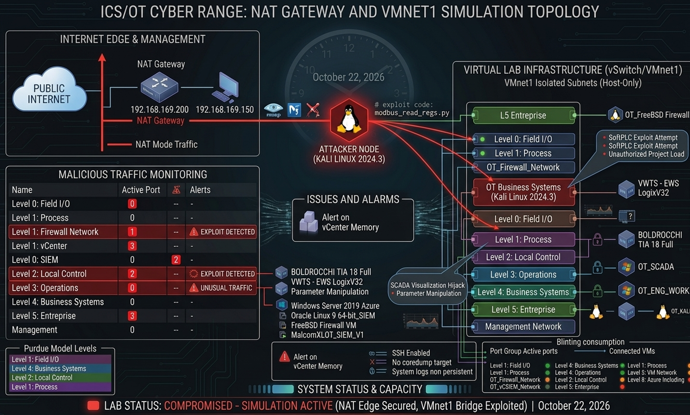

# ICS/OT Cyber Range Lab

A self-hosted, fully isolated Industrial Control Systems (ICS) / Operational Technology (OT) security lab built to practice asset discovery, traffic analysis, and controlled attack simulation against real and virtualized OT equipment, mapped to the Purdue Model.



> **Scope & Safety Notice**
> Everything in this repository was built and tested on hardware and virtual infrastructure **I own**, on a **physically/logically isolated network** (`192.168.169.0/24`) with no path to production systems or the internet. All testing below targets only lab-owned devices. Nothing here is intended for, or should be used against, systems you do not own or have explicit written authorization to test.

## Why this project

Most ICS/OT security resources are theoretical. This lab exists to get hands-on with:
- Building a hybrid virtualization + cloud platform (ESXi → Azure) that can host a realistic Purdue Model environment
- Working with real industrial hardware (Rockwell/Allen-Bradley 1794-AENTR Flex I/O over EtherNet/IP)
- Running controlled reconnaissance and non-destructive attack simulations
- Capturing and analyzing the resulting traffic (Wireshark/Scapy) to understand device behavior under stress

## Repository structure

```
ICS-OT-Cyber-Range-Lab/
├── README.md                          # You are here
├── images/
│   └── network-topology.png           # Cyber range / VMnet1 simulation topology
├── docs/
│   ├── architecture-overview.md       # High-level design + hybrid networking model
│   └── purdue-model-mapping.md        # Asset-to-Purdue-Level matrix
├── lab-setup/
│   ├── 01-bare-metal-esxi-provisioning.md
│   ├── 02-vcenter-deployment.md
│   ├── 03-azure-migrate-bridge.md
│   └── 04-network-zoning-and-hardening.md
└── pentest-projects/
    ├── 1794-AENTR-dos-test/
    │   ├── README.md                  # Project writeup: objectives, method, findings
    │   ├── scripts/
    │   │   └── http_flood_test.py     # Controlled load-test script used against the lab device
    │   └── analysis/
    │       └── pcap_analysis.py       # Scapy-based traffic analysis of the capture
    └── m221-modbus-recon/
        ├── README.md                  # Project template (in progress)
        ├── scripts/
        │   └── modbus_poll_test.py    # Read-only Modbus TCP polling script
        └── analysis/
            └── modbus_pcap_analysis.py # Modbus function-code traffic analysis
```

## Lab environment at a glance

| Component | Role (Purdue Level) | Notes |
|---|---|---|
| ESXi bare-metal host | Hypervisor / Management | Static mgmt IP, Azure Dedicated Host option for cloud-hosted variant |
| vCenter Server Appliance (VCSA) | Central orchestration | Clusters inventory, drives Azure Migrate discovery |
| OT_KALI / OT_SIEM | Level 5 – Enterprise | Attacker/audit node + Security Onion-style IDS/telemetry |
| Site Business Workstations | Level 4 – Business Systems | Enterprise-side resource planning / reporting |
| OT_ENG_WORKSTATION | Level 3 – Operations & Control | PLC programming / logic deployment terminal |
| OT_SCADA | Level 2 – Local Control | HMI + site telemetry aggregation |
| OT_PLC (virtual) / 1794-AENTR (physical) | Level 1 – Process | EtherNet/IP (CIP) field controller |
| Schneider Electric M221 (physical) | Level 1 – Process | Modicon M221 PLC, Modbus TCP control logic |
| Field Sensors & Actuators | Level 0 – Physical I/O | Raw field instrumentation |

Two non-overlapping network planes separate IT and OT traffic: a `10.0.0.0/24` management/security plane and a `192.168.0.0/16` ICS/OT operational plane, with stateful/NGFW inspection and port-mirrored SIEM ingestion between tiers. Full detail in [`docs/architecture-overview.md`](docs/architecture-overview.md).

## Featured projects

### 1794-AENTR reconnaissance & DoS test
A focused exercise against a real Rockwell/Allen-Bradley 1794-AENTR Flex I/O adapter: port discovery (`80/tcp`, `44818/tcp` EtherNet/IP), a controlled HTTP load test, and post-capture traffic analysis in Scapy. See [`pentest-projects/1794-AENTR-dos-test/README.md`](pentest-projects/1794-AENTR-dos-test/README.md) for the full writeup, including findings and mitigation recommendations.

### Schneider Electric M221 — Modbus TCP recon (in progress)
A companion exercise against a real Schneider Electric M221 PLC over Modbus TCP, covering unauthenticated register/coil enumeration and function-code-level traffic analysis — a useful contrast to the EtherNet/IP work above. See [`pentest-projects/m221-modbus-recon/README.md`](pentest-projects/m221-modbus-recon/README.md) (template — results to be filled in as testing is performed).

## Roadmap / ideas for next iterations

- [ ] Add Suricata/Zeek rules tuned for Modbus/EtherNet-IP anomaly detection
- [ ] Script the Purdue-level firewall/ACL rules as Infrastructure-as-Code
- [ ] Expand the DoS writeup with a baseline vs. under-load response-time comparison chart
- [ ] Add a second protocol target (Modbus TCP) for cross-protocol comparison

## Disclaimer

This repository is for educational purposes and documents authorized testing of lab-owned equipment on an isolated network only. The author assumes no responsibility for misuse of any information or code contained here.
